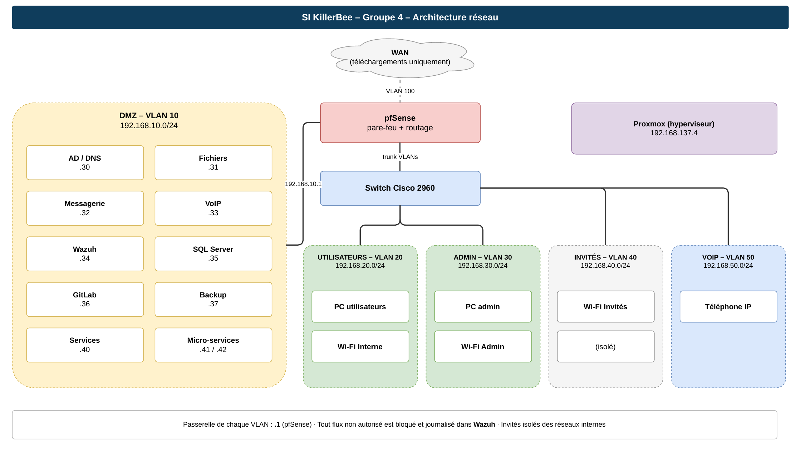
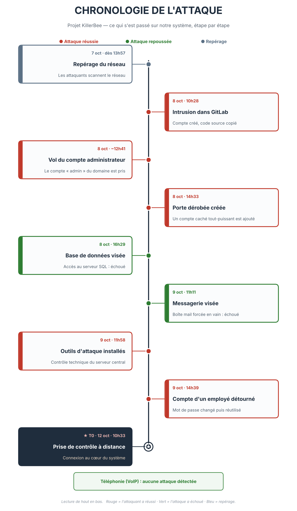

# 🐝 Projet KillerBee — Sécurité offensive & défensive d'un SI

> Projet fil rouge de l'option **Cybersécurité** (CESI École d'Ingénieurs, A5).
> Un même système d'information suivi sur **5 semaines** et **4 phases**, en alternant les postures **Blue Team** (défense) et **Red Team** (offensive) : le concevoir, auditer celui d'une autre équipe, enquêter sur l'attaque subie, puis le corriger.

---

## 🎯 En une phrase

Nous avons **bâti** un SI d'entreprise, **attaqué** celui d'un groupe adverse en équipe offensive, **enquêté** (forensic) sur la compromission de notre propre SI, puis **corrigé et renforcé** les failles — avec, à chaque fois, des **preuves avant / après**.

## 👥 Équipe — Groupe 4

| Membre | Domaine principal |
|--------|-------------------|
| **Sylvère** — *chef de groupe* | Active Directory, forensic, remédiation, coordination |
| **Oumaima** | Active Directory, systèmes |
| **Orphélia** | Réseau, pfSense |
| **Krys** | SQL, GitLab, applicatif |
| **Cyrine** | Applicatif, supervision, cloud |

---

## 🗺️ Les 4 phases

### 1️⃣ Concevoir — *construire un SI sécurisé dès l'origine*
Architecture multi-zones sur **Proxmox** + **pfSense** : 7 VLAN segmentés (DMZ serveurs, Utilisateurs, Admin, VoIP, Invités, Management). **Active Directory** en modèle AGDLP (OU, GPO, PSO), supervision centralisée **Wazuh** (4 sources), stratégie de sauvegarde/chiffrement et sécurité SQL Server.

📂 [`01-concevoir/`](01-concevoir)



### 2️⃣ Auditer — *pentest du SI d'un groupe adverse (Red Team)*
Audit **boîte noire** inspiré du **PTES**, couverture large multi-domaines. Deux chaînes de compromission totale démontrées : une machine web (**Drupalgeddon2 → root**) et l'Active Directory (**pass-the-hash → ZeroLogon → dump NTDS → persistance**). Résultat global : **risque critique**.

📂 [`02-auditer/`](02-auditer)

### 3️⃣ Fouiller — *forensic Blue Team sur notre propre SI*
Reconstruction complète de l'attaque subie via le **SIEM Wazuh** (règles, Event ID, corrélation), distinction **réussites / tentatives repoussées**, et fixation d'un **T0** (point d'ancrage temporel). Deux lectures de la chronologie : une **vulgarisée** (tout public) et une **technique horodatée**.

📂 [`03-fouiller/`](03-fouiller)



### 4️⃣ Optimiser — *remédiation prouvée & plan d'action*
Priorisation de quelques constats critiques, **corrigés à fond et vérifiés** (rejeu du test, avant / après), le reste cadré en **plan Qui / Quoi / Quand / Pourquoi**, plus une **réflexion cloud / hybride** (sauvegardes immuables, externalisation des logs).

📂 [`04-optimiser/`](04-optimiser)

---

## 🔧 Points techniques forts

- **Chaîne d'exploitation Linux** : Drupalgeddon2 (CVE-2018-7600) → script de sauvegarde *world-writable* lancé par cron → élévation `www-data` → `mgmt` → **évasion du groupe `lxd` = root**. Corrigée et **re-testée** (l'exploit ne donne plus de session).
- **Compromission Active Directory** : pass-the-hash, **ZeroLogon (CVE-2020-1472)**, DCSync, persistance (compte caché + RDP). Remédiation : suppression de la persistance, **rotation de la clé `krbtgt` ×2** (parade au *Golden Ticket*), reset des mots de passe faibles.
- **Durcissement réseau** : segmentation pfSense restaurée (retrait des règles *any/any*), LLMNR / NBT-NS.
- **Supervision** : investigation menée dans **Wazuh** (MITRE ATT&CK, règles de corrélation).

## 🧰 Stack & outils

`Proxmox` · `pfSense` · `Active Directory (Windows Server 2012 R2)` · `Wazuh (SIEM)` · `Samba` · `Postfix/Dovecot` · `Asterisk` · `Drupal` · `GitLab` · `MariaDB/SQL Server`
`Kali` · `nmap` · `NetExec` · `Impacket` · `evil-winrm` · `Metasploit` · `Responder` · `BloodHound`

## 📁 Structure du dépôt

```
01-concevoir/   Architecture, plan d'adressage, AD, supervision, composants applicatifs
02-auditer/     Rapport d'audit Red Team + guide d'audit
03-fouiller/    Rapport forensic, journal global, journaux par membre, frises chronologiques
04-optimiser/   Journal de remédiation (preuves avant/après) + synthèses par domaine
soutenance/     Présentation finale (4 phases) + annexe questions-réponses
```

---

## ℹ️ Note

Projet **pédagogique** réalisé sur un **laboratoire isolé** dans le cadre de la formation d'ingénieur CESI. Les adresses IP, identifiants et scénarios d'attaque appartiennent à cet environnement d'entraînement fermé et n'ont aucune portée réelle.
